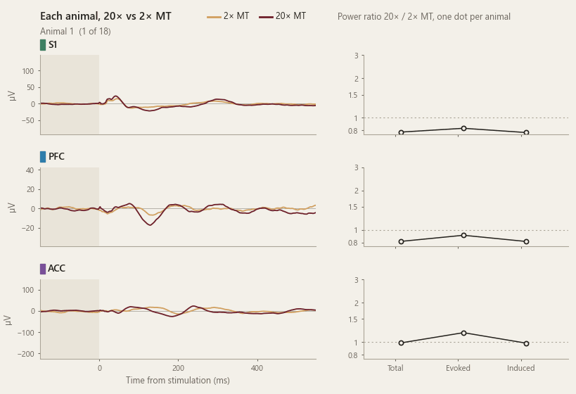
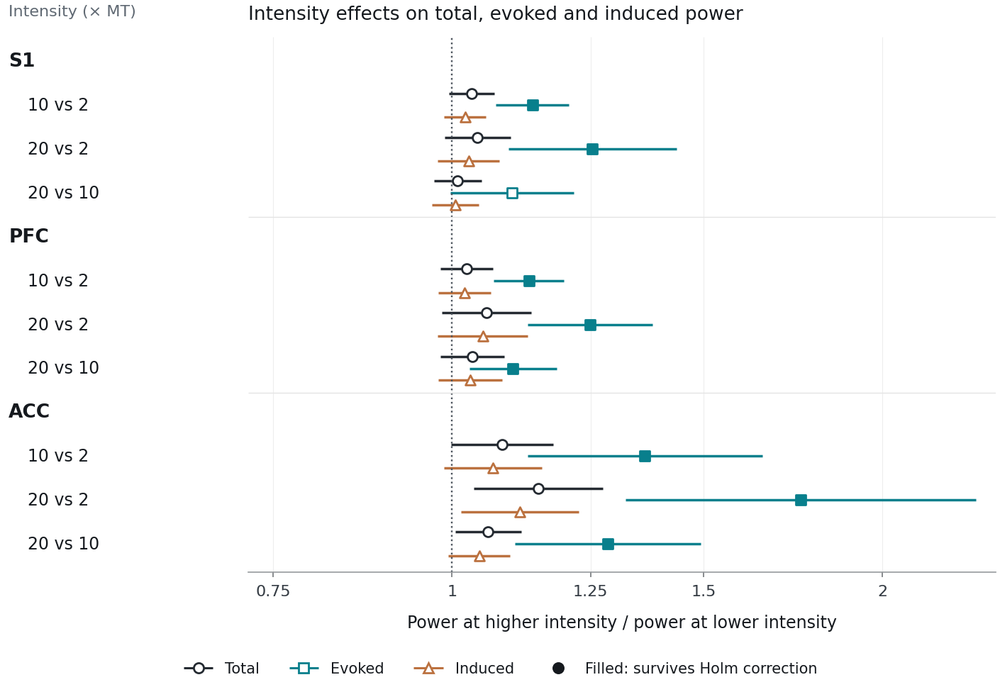

# IASP 2026: Graded Nociceptive Stimulation Across S1, PFC and ACC

[](https://nicaja.github.io/IASP-2026-Graded-Nociceptive-Stimulation/)

*One animal at a time: its waveforms at 2× and 20× motor threshold (MT) and its power ratio, one dot per animal. Evoked power was higher at 20× MT in 14 of 18 animals in S1, 17 of 18 in PFC and 17 of 17 in ACC. [Interactive version](https://nicaja.github.io/IASP-2026-Graded-Nociceptive-Stimulation/)*

Analysis code, results and figures for our IASP 2026 poster and the accompanying article. We recorded S1, PFC and ACC simultaneously in 18 anaesthetised pigs while stimulating the ulnar nerve at 2, 10 and 20 times motor threshold, and asked which part of the cortical response follows stimulus intensity.

**IASP 2026 World Congress on Pain · Bangkok, 26–30 October 2026 · Poster 10418**

## Poster

**Temporal and Spectral Signatures of Graded Nociceptive Stimulation Across S1, PFC, and ACC in a Large-Animal Intracranial Model**

Nickolaj Ajay Atchuthan, Christian Kruse Pedersen, Winnie Jensen and Suzan Meijs. Center for Neuroplasticity and Pain, Aalborg University.

[Poster (PDF)](docs/poster.pdf) · [Interactive page](https://nicaja.github.io/IASP-2026-Graded-Nociceptive-Stimulation/)

The same code produces every result in the article *Graded peripheral nerve stimulation is associated with phase-locked cortical power increases in anaesthetised pigs* (in preparation).

## What we found

Micro-ECoG arrays recorded S1 and PFC and a depth array the ACC (17 animals after quality control) over 154 stimulation sequences. Power at 35–120 Hz over 0–400 ms was compared between intensities with mixed models (animal random effects, Holm correction), and 20–200 Hz time–frequency maps with TFCE.

- Evoked (phase-locked) power was higher at 10× and 20× than at 2× MT in all three regions. At 20× MT it was 1.25 times the 2× MT value in S1 and PFC and 1.75 times in ACC (Holm P ≤ 0.005 for all six contrasts against 2× MT). It was also higher at 20× than at 10× MT in PFC and ACC.
- No total- or induced-power contrast survived correction.
- Four of the nine total-power maps survived correction: 10× and 20× vs 2× MT in S1 and ACC, within about 160 ms of stimulation. Differences were largest at 20–30 Hz, 85–105 ms after stimulation; at 20× vs 2× MT the ACC cluster extended to about 160 Hz.

Separating the response components revealed intensity effects that a broad power average did not, so cortical measures of nociception should state their response component and recording site. Electrical nerve stimulation bypasses peripheral receptors, so responses to natural noxious stimuli may differ, and all animals were female.



*Figure 4. Power ratios between intensities with 95% confidence intervals; filled markers survive Holm correction.*

## Interactive page

The [page](https://nicaja.github.io/IASP-2026-Graded-Nociceptive-Stimulation/) shows every animal's change in total, evoked and induced power for any region and contrast, beside the mixed-model estimate. Each animal's change is the difference between the two intensities within each sequence, averaged within the animal, the same measure correlated in Figure S7. Choosing an animal shows its own waveforms, and the total-power map for the same contrast sits below, outlined where it survives correction. `python -m gradedstim page` writes the page's data and the GIF above from `results/`.

## Figures

| Figure | Shows |
|---|---|
| [Figure 3](docs/figures/fig3_waveforms.png) | Stimulation-locked waveforms in each region |
| [Figure 4](docs/figures/fig4_power_ratios.png) | Total, evoked and induced power ratios |
| [Figure 5](docs/figures/fig5_corrected_maps.png) | The four corrected total-power maps |
| [Figure 6](docs/figures/fig6_aperiodic.png) | Aperiodic exponent, offset and adjusted power (exploratory) |
| [Figure S1](docs/figures/figS1_fraction_common_scale.png) | Phase-locked fraction of total power, common scale |
| [Figure S2](docs/figures/figS2_fraction_region_scales.png) | Phase-locked fraction of total power, scale per region |
| [Figure S3](docs/figures/figS3_all_maps.png) | All nine maps with both correction procedures |
| [Figure S4](docs/figures/figS4_individual_waveforms.png) | Waveforms of every animal |
| [Figure S5](docs/figures/figS5_evoked_fraction.png) | Contrasts of the evoked fraction |
| [Figure S6](docs/figures/figS6_spectra.png) | Static spectra and aperiodic fits |
| [Figure S7](docs/figures/figS7_correlations.png) | Correlations between animal-level responses (exploratory) |

Each figure is also in `docs/figures/` as a PDF.

## Code

| Path | What it holds |
|---|---|
| `config.toml` | Every analysis parameter (frequencies, windows, seeds, permutations) |
| `src/gradedstim/features.py` | Morlet power per recording: total, evoked and induced power, maps, waveforms, spectra |
| `src/gradedstim/models.py` | Mixed models for the 35–120 Hz, 0–400 ms power endpoints and the intensity contrasts |
| `src/gradedstim/maps.py` | Animal-level time–frequency maps with TFCE and maximum-\|t\| correction |
| `src/gradedstim/aperiodic.py` | Exploratory fits of the aperiodic (1/f-like) spectral background |
| `src/gradedstim/correlations.py` | Exploratory correlations between animal-level responses (Figure S7) |
| `src/gradedstim/figures.py`, `tables.py` | Figures 3–6, Figures S1–S7 and Supplementary Tables S1–S6 |
| `src/gradedstim/page.py` | Data for the interactive page and the GIF |
| `results/` | All numbers behind the figures and tables (primary analysis and three sensitivity analyses) |
| `docs/` | The interactive page, the poster and the rendered figures |
| `preprocessing/` | How the cleaned epochs were made from the BIDS recordings |

`results/primary` is the reported analysis. The three other folders are the sensitivity analyses in Supplementary Table S6: averaging the stored repaired channels as they are (`with_copies`), putting back animal 13's ACC recordings (`with_animal13_acc`), and both.

## Running it

Python 3.12 and the pinned packages in `pyproject.toml` (MNE 1.11, NumPy 1.26, statsmodels 0.14.2, FOOOF 1.1.1):

```
pip install -e .          # or: uv sync (exact versions in uv.lock)
python -m gradedstim figures                     # redraw all figures from results/ (no recordings needed)
python -m gradedstim page                        # data for the interactive page and the GIF
python -m gradedstim features --epochs <cleaned epochs folder>
python -m gradedstim statistics
```

`features` takes about 30 minutes on 6 cores and `statistics` about 10 minutes. The cleaned epochs are made from the BIDS recordings with the two scripts in `preprocessing/`.

## Checks against the reported run

Before release, this code was run on the same data and every output was compared with the run reported in the article:

- Features of all 154 sequences agree to floating-point rounding (relative differences below 2 × 10⁻¹³).
- The corrected time–frequency maps, permutation null distributions and corrected masks are identical.
- Power estimates agree within 10⁻¹⁰ and their P values within 10⁻⁷. The aperiodic estimates agree within 2 × 10⁻⁸ (their spectral fits are slightly more sensitive to rounding). Every Holm decision is unchanged in all four analyses.
- Supplementary Tables S1–S6 come out identical to the published tables.
- `preprocessing/clean_epochs.py` reproduces the cleaned epochs of all 154 sequences bit for bit. Re-filtering a raw recording with `make_epochs.py` on a CPU differs from the original GPU-filtered epochs by at most 0.0001 µV.

`pytest` checks the committed results for internal consistency: Holm adjustments, confidence intervals and the map correction.

## Data

The BIDS-formatted recordings are being prepared for release as a separate dataset publication. Until then they are available from the corresponding author on reasonable request.

## License

MIT
